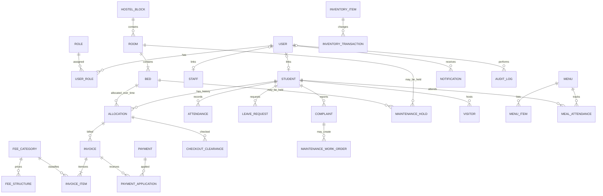

# Advanced Hostel Management System

A Flask and MySQL hostel operations project for learning DBMS concepts through a working application. The database uses MySQL 8.x/InnoDB, explicit foreign keys and constraints, dated allocations, transactional services, and views for derived balances and bed availability.

The schema migrations are provided under `database/migrations/`. On this Mac they have been applied to the newly created `hostel_management` development database on an isolated MySQL 8.4.11 server. The previously installed MySQL 26.7 server and its data directory were left untouched. The app will not create, reset, or migrate databases automatically at startup.

## Features

- Secure password-hash login, logout, CSRF-protected forms, role-checked routes, MySQL-backed sign-in throttling, Super Admin user/role management, and CLI provisioning
- Student create/edit/deactivate, search, filtering, and pagination
- Hostel blocks, rooms, and individual beds; block/room editing, bed relabeling with historical snapshots, and guarded deactivation
- Future reservations, half-open date overlap checks, physical check-in/out, and financial checkout clearance
- Dated fee structures, posted invoices, manual payments, receipts, balances, and payment CSV export
- Attendance, student leave applications and approval, complaints with staff-assigned work orders, maintenance holds, and visitors
- Staff records, mess menus and meal attendance, inventory movement history, and low-stock warnings
- Student self-service for personal allocations, fee balances, leave, complaints, meal attendance, and notifications
- Role-aware, date-filtered dashboards with live MySQL statistics and Chart.js occupancy visualization
- Occupancy CSV export and administrator audit log

The payment records are manual only. No payment gateway, messaging service, or public deployment is configured.

## Requirements

- Python 3.10 or newer
- MySQL 8.x (InnoDB; the migration uses MySQL 8 features including generated columns and `CHECK` constraints)
- Git

On this Mac, Python 3.14.7, Git, MySQL Connector/Python, Flask, Flask-WTF, and pytest are installed in the project `.venv`. MySQL 8.4.11 is installed alongside a separate MySQL 26.7.0 installation. The 26.7 service remains on port 3306; the project uses 8.4 on loopback port 3307 and its own `/opt/homebrew/var/mysql84` data directory and `/tmp/mysql84.sock` socket. The application uses a generated least-privilege MySQL account, not root.

## Local Setup on macOS

### 1. Prepare MySQL

Check both Homebrew services and use the versioned 8.4 client (the unversioned `mysql` command still refers to the existing 26.7 installation):

```sh
brew services list
'/opt/homebrew/opt/mysql@8.4/bin/mysql' --version
```

The `mysql@8.4` server was initialized in a separate data directory and started on port `3307`, so installing it did not replace or migrate the 26.7 data. The project's database was checked, found absent on 8.4, then created. The guarded setup helper checks the server version/port/data directory, refuses to overwrite `.env`, refuses a non-empty target database or an existing app account, applies all ordered migrations, generates credentials locally, and verifies the app connection:

```sh
source .venv/bin/activate
python tools/setup_local.py
```

The MySQL 8.4 server is currently running in a dedicated foreground terminal with the isolated data directory. After a reboot or if that process is stopped, start it with the same explicit paths and keep the terminal open:

```sh
/opt/homebrew/opt/mysql@8.4/bin/mysqld \
  --datadir=/opt/homebrew/var/mysql84 \
  --port=3307 \
  --socket=/tmp/mysql84.sock \
  --pid-file=/opt/homebrew/var/mysql84/mysql.pid \
  --log-error=/opt/homebrew/var/mysql84/mysql.log \
  --bind-address=127.0.0.1 \
  --mysqlx=0
```

Do not start `mysql@8.4` with Homebrew's default service configuration without first configuring its data directory; its default may target `/opt/homebrew/var/mysql`, which belongs to the existing MySQL 26.7 service.

The helper created `.env` with file mode `0600`; its generated secret values were not displayed. It grants the app account only `SELECT`, `INSERT`, `UPDATE`, and `DELETE` on `hostel_management`. If `.env` already exists or the database contains tables, the helper stops without changing the existing state. To inspect the project database, connect to this specific instance:

```sh
'/opt/homebrew/opt/mysql@8.4/bin/mysql' --protocol=socket --socket=/tmp/mysql84.sock -u root hostel_management
```

In MySQL, `SHOW TABLES;` lists the objects; `SELECT VERSION(), DATABASE();` confirms you are connected to MySQL 8.4 and the intended database. The migrations create the tables/views plus five role records, generic fee categories, and login throttling storage. They create no student records. Treat numbered migration scripts as one-time, ordered changes; do not rerun an already applied migration.

### 2. Configure Python and the app

Create an isolated environment and install dependencies:

```sh
python3 -m venv .venv
source .venv/bin/activate
python -m pip install --upgrade pip
python -m pip install -r requirements.txt
```

The setup helper created `.env` securely. Do not display it, commit it, or replace the generated values. Git ignores it. Python packages are listed in `requirements.txt` and installed in the project `.venv`.

For HTTPS hosting, set `SESSION_COOKIE_SECURE=1`. Keep it `0` for local HTTP development.

### 3. Create the first account and run

The initial Super Admin account `admin` has been created and verified with the Super Admin role and a non-empty password hash. Its password was entered through the hidden terminal prompt and is not stored in documentation. For additional role accounts, use the CLI; passwords are entered via a hidden prompt, not as command-line arguments:

```sh
flask --app run.py create-admin
```

Create more role accounts as needed. A student/staff profile must already exist before it can be linked:

```sh
flask --app run.py create-user --role Warden
flask --app run.py create-user --role Accountant
flask --app run.py create-user --role Student --student-number STUDENT-NUMBER
flask --app run.py create-user --role "Mess Manager"
```

Start the development server:

```sh
flask --app run.py run --debug
```

Open <http://127.0.0.1:5001>. The VS Code run task uses port 5001 because macOS Control Center/AirPlay owns port 5000 on this machine. `/health` checks that Flask is running; `/health/ready` checks its MySQL connection.

### 4. Optional fictional demo records

Run the demo seed only against the intended development database. It uses fictional `.example.test` email addresses and is written to avoid duplicating its sample rows when rerun:

```sh
'/opt/homebrew/opt/mysql@8.4/bin/mysql' --protocol=socket --socket=/tmp/mysql84.sock -u root hostel_management < database/seed_demo.sql
```

Never use real student information in a public repository. Dashboard totals are computed from database rows, not hardcoded demo values.

## Tests

Run unit, security, and template checks:

```sh
pytest -q
```

The MySQL integration tests are skipped unless `HOSTEL_TEST_DATABASE` is explicitly set. They insert uniquely named test rows and do not delete them, so use an already migrated **disposable test database**, never your real project or production database. They passed on MySQL 8.4.11 in `hostel_management_test_20261017`:

```sh
'/opt/homebrew/opt/mysql@8.4/bin/mysql' --protocol=socket --socket=/tmp/mysql84.sock -u root -e "CREATE DATABASE hostel_management_test CHARACTER SET utf8mb4 COLLATE utf8mb4_0900_ai_ci;"
for migration in database/migrations/*.sql; do
  '/opt/homebrew/opt/mysql@8.4/bin/mysql' --protocol=socket --socket=/tmp/mysql84.sock -u root hostel_management_test < "$migration"
done
HOSTEL_TEST_DATABASE=hostel_management_test HOSTEL_TEST_USER=root HOSTEL_TEST_UNIX_SOCKET=/tmp/mysql84.sock .venv/bin/python -m pytest -q tests/test_mysql_integration.py
```

Adjust the socket path or use `HOSTEL_TEST_HOST`, `HOSTEL_TEST_PORT`, and `HOSTEL_TEST_PASSWORD` if your MySQL setup differs. The integration suite exercises concurrent same-bed reservations, half-open range boundaries, physical occupancy after planned checkout, fee-based invoicing and payment, checkout clearance, inventory stock constraints, hashed-password login, repeated-failure throttling, and work-order assignment/reassignment.

## Database Design Notes

### Core relationships



A primary key identifies a row; a foreign key enforces a reference to another row. For example, `rooms.block_id` references `hostel_blocks.block_id`, and `beds.room_id` references `rooms.room_id`. Room number is unique within a block; bed label is unique within its room. `user_roles` is a junction table because a user can hold more than one role.

The data is normalized so room/block facts are stored once, allocations represent dated relationships rather than overwriting a student's current room, and invoice items preserve the category/amount charged at the time. `DECIMAL` is used for currency. `v_invoice_balances` derives invoice totals from invoice items and successful payment applications; balances are not separately stored and allowed to drift.

### Allocation rules

Allocation periods are half-open: `[planned_start_date, planned_end_date)`. The start date is included and the end date is excluded. The standard overlap predicate is:

```sql
existing_start < proposed_end
AND proposed_start < existing_end
```

An open-ended period has no end date. The app checks both the student and bed under a transaction. It locks the student, room, and bed parent rows before checking overlaps, so two concurrent requests for the same student or bed serialize. A generated `effective_end_date` respects an actual early checkout while preserving the original planned date. Unique generated columns on physical stays add database-level protection against two active physical allocations for one student or bed.

Scheduled and physical availability differ. A reservation affects scheduled availability; a resident remains physically occupying a bed until `checked_out_at` is recorded, even if the planned end date has passed. `v_bed_availability_today` exposes physical occupancy, scheduled allocation, maintenance hold, scheduled availability, and physical availability as separate values.

Checkout locks the student and its posted invoice records, calculates the outstanding balance from the same invoice-balance view, and records a clearance decision. A positive balance blocks checkout. A successful clearance and actual checkout commit in the same transaction; blocked attempts are retained as history.

### Practice queries

Try these against your local project database and explain what changes if you use an inner join instead of a left join:

```sql
-- Keep empty beds in the result.
SELECT block_name, room_number, bed_label, is_physically_occupied,
       has_scheduled_allocation, has_maintenance_hold, is_scheduled_available
FROM v_bed_availability_today
ORDER BY block_name, room_number, bed_label;

-- Find posted invoices that still have a balance.
SELECT invoice_number, student_id, invoiced_amount, paid_amount, outstanding_amount
FROM v_invoice_balances
WHERE status = 'posted' AND outstanding_amount > 0
ORDER BY outstanding_amount DESC;

-- Practice an aggregate: occupancy by hostel block.
SELECT hb.block_name, COUNT(DISTINCT b.bed_id) AS beds,
       COUNT(DISTINCT CASE WHEN a.checked_in_at IS NOT NULL AND a.checked_out_at IS NULL THEN b.bed_id END) AS occupied
FROM hostel_blocks hb
JOIN rooms r ON r.block_id = hb.block_id
JOIN beds b ON b.room_id = r.room_id
LEFT JOIN allocations a ON a.bed_id = b.bed_id
GROUP BY hb.block_id, hb.block_name;
```

Use `EXPLAIN` before adding an index. Indexes help reads and joins but increase storage and write work. The migration indexes allocation owner/date lookups, foreign keys used by reports, payment dates, and audit lookups. Transaction tests are in `tests/test_mysql_integration.py`.

## Project Structure

```text
app/
  auth.py                 Login, role decorators
  cli.py                  Admin and role account provisioning
  config.py               Environment configuration
  dashboard.py            Role-aware, data-driven dashboards
  db.py                   Pooled MySQL helpers
  routes.py                Feature routes, validation, CSV exports
  services/               Transactional domain operations
  templates/               Jinja pages
  static/                  CSS and JavaScript
database/
  migrations/
    001_initial.sql
    002_login_throttling.sql
    003_allocation_bed_label_snapshot.sql
  seed_demo.sql
 tests/
  test_app.py
  test_mysql_integration.py
run.py
requirements.txt
.env.example
```

## Current Verification and Known Limits

Verified during development: Python compilation; twelve default unit/security/template tests; both migrations applied to the isolated MySQL 8.4.11 `hostel_management` database; generated least-privilege app account connection; administrator role and non-empty password hash; eight integration tests on a separate MySQL 8.4.11 test schema covering simultaneous bookings, financial clearance, inventory constraints, authenticated page/report rendering, password-hash login, sign-in throttling, work-order assignment, protected room/bed deactivation, and historical invoice preservation after fee-rule retirement.

The current version is a college-project foundation, not a production hostel platform. User and role management, admin/self-service password resets, block/room edits, bed relabeling, guarded deactivation, and selected-date dashboard summaries are implemented. Bed labels are snapshotted per allocation so relabeling does not rewrite history. Fee structures can be created and retired but not edited in place; work-order assignment is supported but assignment history is not separately modeled; password reset is local/admin-mediated rather than email-based; Chart.js and Bootstrap are loaded from CDNs. Business mutation audit rows are written in the same transaction as their changes. These remaining limitations are documented rather than claimed as complete.

## Safety

- Keep `.env`, database passwords, and real student records out of Git.
- Use fictional demo data only in development.
- The app uses parameterized SQL, server-side role checks, password hashing, CSRF protection, input checks, and safe error messages.
- Do not grant the application database user schema-changing privileges for normal operation.
- Never run integration tests against a live or important database; the tests intentionally leave their test records behind.
- No real payments, messages, or deployments are performed by this project.
