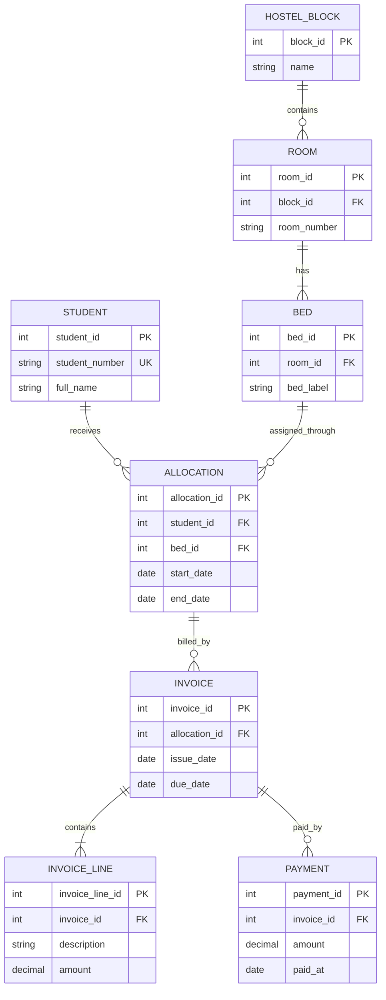

git commit -m "Add hostel management DBMS project guide"
# Advanced Hostel Management System

A college DBMS project built to learn MySQL by designing and testing the database yourself. The database is the first deliverable. We will not start Flask or implement application modules until you finish the database checklist, test your schema, and tell me you are ready.

This repository currently contains this guide only. No schema or application has been generated for you.

## Project Requirements

The eventual system should support:

- Students and their hostel stays
- Hostel blocks, rooms, beds, and occupancy
- Time-bounded bed allocations, including check-in and check-out
- Invoices, fee line items, and payments
- Attendance and student leave records
- Complaints and maintenance work
- Visitors and visit records
- Mess plans, staff, and inventory
- User accounts, roles, notifications, and audit history
- Operational dashboards, analytics, and CSV reports

For the first database iteration, focus on students, blocks, rooms, beds, allocations, invoices, invoice line items, and payments. Record assumptions before designing tables. For example, decide whether students can have more than one active allocation, whether a room can have different bed counts over time, how an invoice relates to a stay, and whether partial payments are allowed.

## Starting ER Diagram

This is a discussion model, not a finished schema. Review it, write down corrections and assumptions, and then create your own relational schema. In particular, decide how to enforce that a bed cannot have overlapping active allocations.



Crow's-foot guide: `||` means exactly one; `o{` means zero or many; `|{` means one or many. The diagram shows a starting point only. For example, whether each invoice must have at least one line, how cancellations are represented, and how overlapping allocation dates are prevented are design questions for you to answer.

## Database Phase Setup

You need MySQL Server and its command-line client. On this Mac, MySQL has already been installed and its Homebrew service started. Check the service and connect:

```sh
brew services list
mysql --version
mysql -u root
```

If your local MySQL account has a password, connect with `mysql -u root -p`. In the MySQL prompt, create your project database and select it:

```sql
CREATE DATABASE hostel_management;
USE hostel_management;
```

Do not install Flask or start application development during this phase. You may use MySQL Workbench if you prefer a visual client, but practice running the SQL yourself as well.

## Learning Sequence

Work through these stages in order. Write your answers and SQL in your own notes or local SQL files. Share your attempt and the exact MySQL error or output when you want help; I will explain the issue and guide a correction without replacing the exercise with a finished solution.

1. **Requirements and business rules:** List data to store, users of the system, reports, and rules. Separate facts from derived values. Decide what happens on cancellation, room changes, partial payment, and checkout.
2. **ER modeling:** Review the starting diagram. Identify entities, attributes, relationship cardinalities, optional relationships, and business rules that an ER diagram cannot express clearly.
3. **Relational schema:** Map entities to tables. Choose candidate keys and primary keys; identify foreign keys; choose appropriate data types; document each decision.
4. **Normalization:** Start from a deliberately unnormalized sample spreadsheet of hostel stays and fees. Identify repeating groups, partial dependencies, and transitive dependencies. Decompose it through 1NF, 2NF, and 3NF and explain anomalies avoided.
5. **Table creation:** Write your own `CREATE TABLE` statements. Add primary keys, foreign keys, `NOT NULL`, `UNIQUE`, `CHECK`, and default values where justified. Use InnoDB and name constraints clearly.
6. **Seed data and integrity tests:** Insert fictional blocks, rooms, beds, students, stays, invoices, lines, and payments. Test valid and invalid inserts, duplicate keys, missing foreign keys, and date/amount rules.
7. **Joins:** Write queries using `INNER JOIN` and `LEFT JOIN`. Compare which rows disappear or remain when related data is missing.
8. **Subqueries and aggregates:** Practice correlated and non-correlated subqueries, `COUNT`, `SUM`, `AVG`, `GROUP BY`, and `HAVING` for occupancy, debt, and revenue reports.
9. **Views and indexes:** Create a useful reporting view. Use `EXPLAIN` before and after adding an index; explain the indexed columns and the trade-off for inserts and updates.
10. **Transactions:** Demonstrate `START TRANSACTION`, `COMMIT`, and `ROLLBACK`. Model allocation as an atomic operation and investigate concurrency and overlapping-date problems.
11. **Database testing:** Keep repeatable setup/seed/test scripts. Verify constraints, expected query results, transaction rollback, and behavior when records are absent.

## Exercises: You Write These Queries

Use your own table and column names after you finalize the schema. Do not paste real student data into this public repository.

- List students with their current bed, room, and block.
- List every room with its number of beds and currently occupied beds, including empty rooms.
- Find beds available on a date range you choose. Explain how your query treats checkout dates and overlapping stays.
- Find students with no active allocation using an outer join or a `NOT EXISTS` subquery.
- Calculate the unpaid balance for every invoice, including invoices with no payments.
- Calculate monthly collected revenue and total billed amounts separately.
- Find blocks whose occupancy is above a threshold using `GROUP BY` and `HAVING`.
- Create a view for a read-only occupancy report.
- Use `EXPLAIN` to compare a report query before and after an index you chose.
- In a transaction, attempt an allocation and deliberately trigger a rule violation; prove the earlier writes were rolled back.

When asking for help, include your query, the exact error/result, and the relevant table definitions. I will explain the underlying DBMS concept, point out the smallest correction, and give you a follow-up exercise.

## Database Completion Checklist

Do not move to the application phase until you can check every item and confirm completion to me.

- [ ] Written functional requirements, assumptions, and business rules
- [ ] Reviewed and revised the ER diagram with cardinalities and optionality
- [ ] Explained primary keys, candidate keys, and foreign-key relationships
- [ ] Produced a 1NF-to-3NF normalization example and explained the result
- [ ] Personally wrote and ran the schema creation SQL in MySQL
- [ ] Added realistic fictional seed data and tested constraints with valid and invalid cases
- [ ] Completed the join, subquery, aggregate, and view exercises
- [ ] Used `EXPLAIN` and justified at least one index
- [ ] Demonstrated a transaction that commits and one that rolls back
- [ ] Saved repeatable schema, seed, query, and test scripts
- [ ] Captured successful test results and documented known limitations

When the checklist is complete, tell me: **“Database phase complete; schema tested.”** Share your schema and test results with that confirmation. I will inspect and reuse your design, then begin the remaining application phases. I will not silently replace your schema. If an application feature truly requires a schema change, I will explain why, propose a data-preserving migration, and ask before any destructive change.

## After Database Completion

Once you confirm the database phase, implementation proceeds in dependency order: Flask environment and database integration; authentication, password hashing, CSRF protection, and role authorization; student and hostel/bed/allocation workflows; invoices, fees, and payments; attendance and leave; complaints and maintenance; visitors; mess, staff, and inventory; notifications and audit logs; dashboards, analytics, and CSV exports; then automated tests, security checks, bug fixes, and documentation.

No real payments, messages, public deployments, or other consequential external actions will be performed without your explicit approval. Credentials belong in local environment configuration, never in source control.

## Demonstration Guide

For the database-phase presentation, show the ER diagram and explain a normalization decision, create the schema from your SQL scripts, insert fictional test records, run one join and one aggregate report, show a constraint rejecting invalid data, and demonstrate a transaction rollback. Keep the exact commands and results you used so the work is repeatable.
